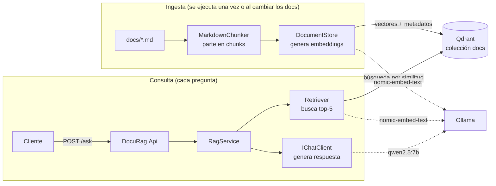
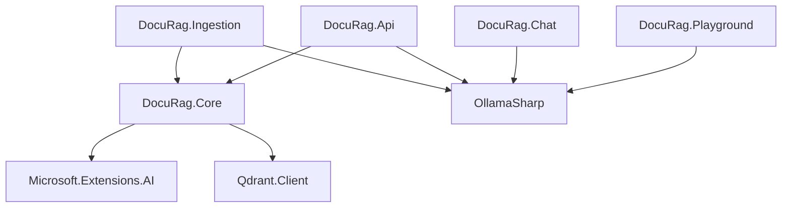
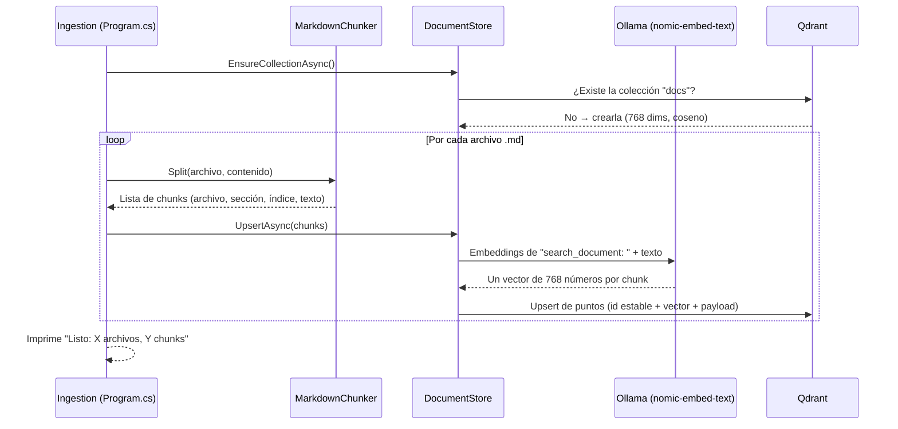
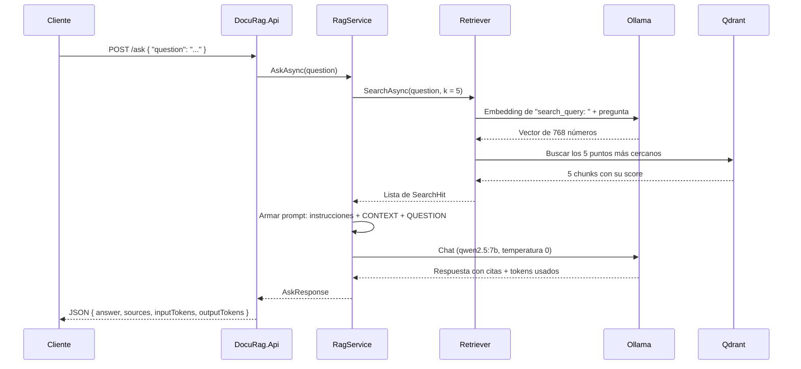

# DocuRAG .NET

Sistema de **preguntas y respuestas sobre documentación técnica** construido en C# / .NET con **RAG** (Retrieval-Augmented Generation). Lee documentos Markdown, los guarda como vectores en **Qdrant** y responde preguntas con un **LLM local** (Ollama), citando de qué documento sacó cada dato.

Todo corre en tu propio PC y es gratis: no necesitas cuentas de pago ni claves de API.

> Proyecto de aprendizaje de IA aplicada en .NET. La sección [Prácticas](#prácticas) documenta qué se construyó y qué se aprendió en cada parte.

---

## Contenido

1. [Estado del proyecto](#estado-del-proyecto)
2. [Qué hace y por qué](#qué-hace-y-por-qué)
3. [Arquitectura](#arquitectura)
4. [Flujos](#flujos)
5. [Instalación](#instalación)
6. [Uso](#uso)
7. [Configuración](#configuración)
8. [Prácticas](#prácticas)
9. [Solución de problemas](#solución-de-problemas)
10. [Limitaciones conocidas](#limitaciones-conocidas)
11. [Glosario](#glosario)
12. [Recursos y créditos](#recursos-y-créditos)

---

## Estado del proyecto

| Funcionalidad | Estado |
|---|---|
| Fundamentos de LLMs y chat de consola | ✅ Hecho |
| Embeddings, chunking y pipeline de ingesta | ✅ Hecho |
| RAG completo como API con citas | ✅ Hecho |
| Tool calling, salida estructurada y agentes | ⏳ Pendiente |
| Harness de evaluación, telemetría y seguridad | ⏳ Pendiente |
| Documentación final | ⏳ Pendiente |

---

## Qué hace y por qué

### El problema

Un LLM (como los de ChatGPT o Claude) solo sabe lo que aprendió durante su entrenamiento. No conoce los documentos internos de tu empresa, y si le preguntas por ellos, puede **inventar** una respuesta convincente (a esto se le llama *alucinación*).

Tampoco puedes pegarle todos tus documentos en cada pregunta: no caben en su **ventana de contexto**, y aunque cupieran sería lento y caro.

### La solución: RAG

RAG funciona como un examen a libro abierto:

1. **Antes** de preguntar, se preparan los documentos: se parten en fragmentos pequeños (*chunks*) y cada uno se convierte en un vector que representa su significado.
2. **Al preguntar**, se buscan solo los 5 fragmentos más relacionados con la pregunta.
3. Se le entregan esos fragmentos al LLM junto con la pregunta, con la instrucción de **responder solo con esa información y citar la fuente**.

Así el modelo no necesita "saber" la respuesta: solo necesita leer bien.

### Qué documentos usa

La carpeta [`docs/`](docs/) contiene la documentación oficial de Microsoft sobre **IA en .NET** (64 archivos Markdown, en inglés, más imágenes y fragmentos de código que la ingesta ignora). Es un buen conjunto de prueba: documentación técnica real, con estructura de títulos y temas variados. Por eso las preguntas al sistema se hacen en inglés.

---

## Arquitectura

### Vista general



Hay **dos fases** separadas:

- **Ingesta** (offline): convierte los documentos en vectores y los guarda. Se ejecuta una vez, o cuando cambian los documentos.
- **Consulta** (online): por cada pregunta, busca los fragmentos relevantes y genera la respuesta.

Y **dos servicios externos**, ambos corriendo en tu PC:

| Servicio | Para qué | Puerto |
|---|---|---|
| **Ollama** | Ejecuta los modelos de IA: uno para embeddings y otro para conversar | `11434` |
| **Qdrant** (en Docker) | Base de datos vectorial que guarda los chunks y busca por similitud | `6333` (panel web / REST), `6334` (gRPC, el que usa el código) |

### Proyectos de la solución

```
docurag-dotnet/
├─ docs/                       Documentos a indexar (Markdown)
├─ src/
│  ├─ DocuRag.Core/            Librería con toda la lógica de RAG
│  ├─ DocuRag.Ingestion/       Consola: indexa docs/ en Qdrant
│  ├─ DocuRag.Api/             API web: endpoint POST /ask
│  ├─ DocuRag.Chat/            Consola: chat simple con el LLM
│  └─ DocuRag.Playground/      Consola: experimentos con embeddings
└─ DocuRag.slnx                Solución
```

| Proyecto | Tipo | Responsabilidad |
|---|---|---|
| `DocuRag.Core` | Librería de clases | Modelo de datos, chunking, almacenamiento vectorial, búsqueda y servicio RAG. No sabe nada de consolas ni de HTTP. |
| `DocuRag.Ingestion` | Consola | Recorre una carpeta, parte cada archivo y lo guarda en Qdrant usando `Core`. |
| `DocuRag.Api` | ASP.NET Core Minimal API | Registra las dependencias y expone `POST /ask` usando `Core`. |
| `DocuRag.Chat` | Consola | Chat con historial y streaming. Independiente: sirvió para aprender lo básico. |
| `DocuRag.Playground` | Consola | Compara frases con similitud coseno para ver los embeddings en acción. Independiente. |



**Por qué esta separación:** la lógica vive en `Core` y los ejecutables solo la "conectan". Así la ingesta, la API y, más adelante, los tests de evaluación reutilizan exactamente el mismo código. `Core` depende de **interfaces** (`IChatClient`, `IEmbeddingGenerator`), no de Ollama: los ejecutables deciden qué proveedor usar.

### Componentes de `DocuRag.Core`

| Archivo | Qué es | Qué hace |
|---|---|---|
| [`Chunk.cs`](src/DocuRag.Core/Chunk.cs) | `record Chunk(File, Section, Index, Text)` | Un fragmento de documento con sus metadatos. |
| [`MarkdownChunker.cs`](src/DocuRag.Core/MarkdownChunker.cs) | Clase estática | Parte un Markdown en chunks de hasta ~2000 caracteres. Limpia el *front matter*, corta por títulos y párrafos, y repite el último párrafo al inicio del chunk siguiente (solapamiento). |
| [`DocumentStore.cs`](src/DocuRag.Core/DocumentStore.cs) | Clase | Crea la colección `docs` en Qdrant (vectores de 768 dimensiones, distancia coseno), genera los embeddings de los chunks y los guarda con *upsert*. |
| [`Retriever.cs`](src/DocuRag.Core/Retriever.cs) | Clase + `record SearchHit` | Convierte la pregunta en vector y pide a Qdrant los *k* chunks más parecidos. |
| [`RagService.cs`](src/DocuRag.Core/RagService.cs) | Clase + `record AskResponse` | Orquesta el RAG: busca, arma el prompt con el contexto, llama al LLM y devuelve respuesta, fuentes y tokens usados. |

### Decisiones de arquitectura

| Decisión | Por qué | Alternativa descartada |
|---|---|---|
| **`Microsoft.Extensions.AI`** (`IChatClient`, `IEmbeddingGenerator`) | Abstracción independiente del proveedor. Cambiar de Ollama a Azure OpenAI es cambiar una línea. Permite añadir middleware (logging, telemetría, caché, tool calling) como en ASP.NET Core. | Usar directamente el SDK de un proveedor: acopla todo el código a ese proveedor. |
| **Modelos locales con Ollama** | Gratis, sin claves de API, y los documentos no salen del PC (privacidad). | APIs de pago: modelos más capaces, pero con costo y datos enviados a terceros. |
| **`qwen2.5:7b`** como LLM | Buen equilibrio entre calidad y velocidad en un PC con 16 GB de RAM; sigue bien instrucciones y soporta tool calling. | `llama3.2:3b`: más rápido pero menos fiable. |
| **`nomic-embed-text`** para embeddings | Abierto, ligero, 768 dimensiones, bueno en inglés (el idioma de los docs). | `bge-m3`: multilingüe, sería la opción para documentos en español. |
| **Qdrant** como base vectorial | Dedicada, open source, fácil de correr con Docker, cliente oficial para .NET y panel web para inspeccionar datos. | pgvector (si ya hubiera PostgreSQL), Azure AI Search (si todo estuviera en Azure). |
| **Chunking por títulos y párrafos, ~2000 caracteres, solapamiento de 1 párrafo** | Respeta la estructura del documento y no corta ideas a la mitad. ~2000 caracteres ≈ 500 tokens, un punto de partida razonable. Se ajustará midiendo con un harness de evaluación. | Cortar cada N caracteres fijos: rompe frases y mezcla secciones. |
| **Ids estables** (`MD5(archivo#índice)`) + **upsert** | La ingesta es **idempotente**: ejecutarla varias veces no duplica datos. | `Guid.NewGuid()`: cada ejecución duplicaría todos los puntos. |
| **Temperatura 0** en las respuestas RAG | Respuestas estables y repetibles, pegadas al contexto. | Temperatura alta: más variedad, más riesgo de inventar. |
| **Prompt que exige citar y admitir "no lo sé"** | Reduce alucinaciones y permite verificar cada afirmación. | Prompt libre: el modelo completa con lo que "cree" saber. |
| **Prompt en inglés** | Los documentos están en inglés y los modelos pequeños siguen mejor instrucciones en inglés. | Prompt en español: posible, pero menos fiable con este modelo. |

---

## Flujos

### Flujo de ingesta

Se ejecuta con `dotnet run --project src/DocuRag.Ingestion -- docs`.



Paso a paso:

1. **Asegurar la colección.** Si `docs` no existe en Qdrant, se crea indicando el tamaño de los vectores (768) y cómo compararlos (coseno).
2. **Leer archivos.** Se buscan todos los `.md` de la carpeta, incluidas las subcarpetas.
3. **Limpiar.** Se quita el bloque de metadatos `---` (*front matter*) del inicio de cada archivo.
4. **Partir en chunks.** Cada título (`#`) empieza una sección nueva; los párrafos se acumulan hasta ~2000 caracteres; al cortar, el último párrafo se repite en el siguiente chunk.
5. **Generar embeddings.** Todos los chunks de un archivo se envían juntos a Ollama, con el prefijo `search_document: ` que recomienda el modelo.
6. **Guardar.** Cada chunk se guarda como un *punto* de Qdrant: id estable, vector y *payload* (`file`, `section`, `text`).

### Flujo de consulta (`POST /ask`)



Paso a paso:

1. **Llega la pregunta** como JSON.
2. **Retrieval.** La pregunta se convierte en vector con el **mismo modelo** que se usó para los documentos (si no, los vectores no serían comparables), esta vez con el prefijo `search_query: `.
3. **Búsqueda.** Qdrant devuelve los 5 chunks con mayor similitud coseno, con su `score`.
4. **Augmentation.** Se arma el prompt. Cada chunk va precedido de su fuente:

   ```text
   [System]
   You are a documentation assistant.
   Answer ONLY using the information in the CONTEXT.
   After each statement, cite the source as [file#section].
   If the answer is not in the CONTEXT, say: "I don't know based on the documentation."
   Be concise.

   [User]
   CONTEXT:
   [ichatclient.md#Use the IChatClient interface]
   ...texto del chunk...

   ---

   [microsoft-extensions-ai.md#The `IChatClient` interface]
   ...texto del chunk...

   QUESTION: What is IChatClient?
   ```

5. **Generation.** El LLM responde con temperatura 0.
6. **Respuesta.** Se devuelve la respuesta, las fuentes usadas y los tokens consumidos.

---

## Instalación

Probado en **Windows 11** con PowerShell.

### Requisitos

| Herramienta | Versión | Para qué |
|---|---|---|
| .NET SDK | 11 (los proyectos apuntan a `net11.0`) | Compilar y ejecutar |
| Ollama | 0.3 o superior | Ejecutar los modelos de IA |
| Docker Desktop | Reciente | Ejecutar Qdrant |
| Git | Cualquiera | Clonar el repositorio |
| RAM | 16 GB recomendado (8 GB con un modelo más pequeño) | El modelo de 7B ocupa unos 5 GB |

### 1. Instalar las herramientas

```powershell
winget install Microsoft.DotNet.SDK.11
winget install Ollama.Ollama
winget install Docker.DockerDesktop
winget install Git.Git
```

Cierra y vuelve a abrir PowerShell para que reconozca los nuevos comandos. Docker Desktop puede pedir reiniciar el PC.

### 2. Descargar los modelos

```powershell
ollama pull qwen2.5:7b
ollama pull nomic-embed-text
```

Comprueba que están descargados:

```powershell
ollama list
```

> **¿Tienes 8 GB de RAM?** Usa `ollama pull llama3.2:3b` y cambia `qwen2.5:7b` por `llama3.2:3b` en [`src/DocuRag.Api/Program.cs`](src/DocuRag.Api/Program.cs) y [`src/DocuRag.Chat/Program.cs`](src/DocuRag.Chat/Program.cs).

### 3. Levantar Qdrant

Abre Docker Desktop y espera a que diga *Engine running*. Después:

```powershell
docker run -d --name qdrant -p 6333:6333 -p 6334:6334 -v qdrant_data:/qdrant/storage qdrant/qdrant
```

- `-d`: corre en segundo plano.
- `-p 6333` y `-p 6334`: publica el puerto del panel web y el del cliente .NET.
- `-v qdrant_data:...`: guarda los datos en un volumen, así no se pierden al reiniciar.

Las siguientes veces solo necesitas:

```powershell
docker start qdrant
```

Panel web: <http://localhost:6333/dashboard>

### 4. Clonar y compilar

```powershell
git clone https://github.com/mauricio2491/docurag-dotnet.git
cd docurag-dotnet
dotnet build
```

### 5. Verificar que todo está listo

| Comprobación | Comando | Resultado esperado |
|---|---|---|
| .NET | `dotnet --version` | Empieza por `11.` |
| Ollama | `ollama list` | Aparecen `qwen2.5:7b` y `nomic-embed-text` |
| Qdrant | `docker ps` | Un contenedor `qdrant` en estado *Up* |
| Compilación | `dotnet build` | `Compilación correcta` / `Build succeeded` |

---

## Uso

Ejecuta todos los comandos desde la **raíz del repositorio** (la carpeta que contiene `DocuRag.slnx`), porque la ruta `docs` es relativa.

### 1. Indexar los documentos

```powershell
dotnet run --project src/DocuRag.Ingestion -- docs
```

Salida esperada (abreviada; los números dependen de tus documentos):

```text
  N chunks  ichatclient.md
  N chunks  microsoft-extensions-ai.md
...
Listo: 64 archivos, N chunks.
```

Puedes ejecutarlo las veces que quieras: no duplica datos. Para comprobarlo, cuenta los puntos antes y después:

```powershell
(Invoke-RestMethod -Method Post -Uri http://localhost:6333/collections/docs/points/count -ContentType "application/json" -Body '{"exact": true}').result.count
```

### 2. Arrancar la API

```powershell
dotnet run --project src/DocuRag.Api
```

Escucha en `http://localhost:5172` (configurado en [`launchSettings.json`](src/DocuRag.Api/Properties/launchSettings.json)). Deja esta ventana abierta.

### 3. Hacer preguntas

En **otra** ventana de PowerShell:

```powershell
$api = "http://localhost:5172"
$body = @{ question = "What is IChatClient and why should I use it?" } | ConvertTo-Json
$r = Invoke-RestMethod -Method Post -Uri "$api/ask" -ContentType "application/json" -Body $body
$r.answer
$r.sources | Format-Table file, section, score
```

Forma de la respuesta:

```json
{
  "answer": "IChatClient is an interface ... [ichatclient.md#Use the IChatClient interface]",
  "sources": [
    { "file": "ichatclient.md", "section": "Use the IChatClient interface", "text": "...", "score": 0.78 }
  ],
  "inputTokens": 1450,
  "outputTokens": 120
}
```

Prueba también una pregunta que **no** está en los documentos, por ejemplo `"What is the capital of France?"`. Lo esperado es que responda que no lo sabe según la documentación.

### Otros programas

```powershell
# Chat de consola con historial. Escribe 'salir' para terminar.
dotnet run --project src/DocuRag.Chat

# Experimento de similitud entre frases
dotnet run --project src/DocuRag.Playground
```

---

## Configuración

Por ahora los valores están escritos en el código. Moverlos a `appsettings.json` es una mejora pendiente.

| Valor | Actual | Dónde cambiarlo |
|---|---|---|
| URL de Ollama | `http://localhost:11434` | `Program.cs` de Api, Ingestion, Chat y Playground |
| Modelo de chat | `qwen2.5:7b` | `src/DocuRag.Api/Program.cs`, `src/DocuRag.Chat/Program.cs` |
| Modelo de embeddings | `nomic-embed-text` | `Program.cs` de Api, Ingestion y Playground |
| Host de Qdrant | `localhost` (puerto gRPC 6334) | `src/DocuRag.Api/Program.cs`, `src/DocuRag.Ingestion/Program.cs` |
| Nombre de la colección | `docs` | `DocumentStore.Collection` |
| Dimensión de los vectores | `768` | `DocumentStore.EnsureCollectionAsync` (debe coincidir con el modelo de embeddings) |
| Tamaño máximo de chunk | `2000` caracteres | `MarkdownChunker.Split`, parámetro `maxChars` |
| Chunks por consulta (*k*) | `5` | `RagService.AskAsync`, parámetro `k` |
| Puerto de la API | `5172` | `src/DocuRag.Api/Properties/launchSettings.json` |

> Si cambias el **modelo de embeddings**, tienes que borrar la colección `docs` (desde el panel de Qdrant) y volver a ejecutar la ingesta: los vectores de modelos distintos no son comparables y suelen tener otra dimensión.

---

## Prácticas

Registro de lo construido y aprendido en cada etapa.

### Fundamentos de LLMs y chat de consola

**Proyecto:** [`DocuRag.Chat`](src/DocuRag.Chat/Program.cs)

**Objetivo:** entender qué pasa en cada llamada a un modelo y hablar con uno desde C#.

**Qué hace el código:**

1. Crea un `IChatClient` apuntando a Ollama.
2. Mantiene una lista `history` que empieza con un mensaje de sistema.
3. En cada vuelta añade el mensaje del usuario, pide la respuesta en **streaming** (llega por trozos) y la guarda en el historial.

**Experimentos:**

| Experimento | Resultado | Conclusión |
|---|---|---|
| No guardar la respuesta del asistente en el historial | Las preguntas de seguimiento pierden el sentido | El modelo **no tiene memoria**: el código reenvía el historial en cada llamada |
| Cambiar el system prompt (por ejemplo, "responde como pirata") | Cambia todo el comportamiento | El mensaje de sistema es la herramienta de control más directa |
| Misma pregunta con temperatura 0 y 1.5 | Con 0 casi iguales; con 1.5 varían | Para responder sobre documentos se usa temperatura baja |
| Ver los tokens de entrada en cada turno | Crecen con cada mensaje | El historial cuesta tokens y llena la ventana de contexto |

**Conceptos:** LLM, token, ventana de contexto, roles, temperatura, streaming, `IChatClient`.

### Embeddings, chunking e ingesta

**Proyectos:** [`DocuRag.Playground`](src/DocuRag.Playground/Program.cs), [`DocuRag.Core`](src/DocuRag.Core), [`DocuRag.Ingestion`](src/DocuRag.Ingestion/Program.cs)

**Objetivo:** construir la "R" de RAG: el pipeline que convierte documentos en vectores buscables.

**Práctica 1, Playground.** Se generan embeddings de varias frases y de una pregunta, y se calcula la similitud coseno entre ellos. Las frases sobre vacaciones y días libres obtienen el puntaje más alto ante "¿Cómo pido unos días de descanso?", aunque no compartan palabras. Eso es **búsqueda semántica**.

Lo importante: **no se compara texto contra texto**. El modelo de embeddings convierte cada texto en 768 números, y la comparación es matemática (`TensorPrimitives.CosineSimilarity`), ejecutada en C# sin IA.

**Práctica 2, Ingesta.** Ver [Flujo de ingesta](#flujo-de-ingesta).

**Verificación de idempotencia:** contar los puntos de Qdrant, ejecutar la ingesta de nuevo y volver a contar. El número no cambia porque cada chunk tiene un id calculado a partir de su archivo y posición, y `Upsert` reemplaza en lugar de insertar.

**Conceptos:** embedding, vector, similitud coseno, chunking, solapamiento, metadatos, base vectorial, idempotencia.

### RAG completo como API

**Proyectos:** [`DocuRag.Core`](src/DocuRag.Core) (`Retriever`, `RagService`), [`DocuRag.Api`](src/DocuRag.Api/Program.cs)

**Objetivo:** unir búsqueda y generación en un endpoint real que cite sus fuentes.

**Qué se construyó:**

- `Retriever`: búsqueda top-*k* en Qdrant.
- `RagService`: prompt con contexto, instrucciones de citar y de admitir "no lo sé", temperatura 0, y conteo de tokens.
- `DocuRag.Api`: registro de dependencias por interfaces y endpoint `POST /ask`.

**Troubleshooting de calidad.** Ante una mala respuesta, la pregunta clave es: **¿el chunk correcto estaba en las fuentes?**

| Situación | Tipo de fallo | Qué mejorar |
|---|---|---|
| La respuesta es mala y el chunk correcto **no** está en `sources` | **Retrieval** | Chunking, modelo de embeddings, búsqueda híbrida, reescritura de la pregunta |
| El chunk correcto **sí** está, pero la respuesta es mala | **Generación** | Prompt, modelo más capaz, menos ruido en el contexto |

**Conceptos:** RAG, retrieval, augmentation, generation, top-*k*, grounding, citas, inyección de dependencias.

### Próximas etapas

- **Tool calling y agentes:** que el modelo decida cuándo buscar, salida estructurada con records tipados, agentes, Semantic Kernel / Microsoft Agent Framework, MCP, y el primer ADR.
- **Evaluación y seguridad:** *harness* de evaluación con xUnit (golden set, recall@5, MRR, LLM-as-judge), telemetría (latencia y tokens), y prueba de *prompt injection*.
- **Documentación final:** versión final del README.

---

## Solución de problemas

Errores reales encontrados durante el desarrollo.

| Síntoma | Causa | Solución |
|---|---|---|
| `HttpRequestException: 404 (Not Found)` al generar embeddings o chatear | El modelo no está descargado en Ollama o el nombre no coincide | `ollama list` para ver los nombres exactos; `ollama pull nomic-embed-text` si falta |
| `No connection could be made` / `Connection refused` al puerto 11434 | Ollama no está corriendo | Abre Ollama desde el menú Inicio |
| Error de conexión gRPC al puerto 6334 | El contenedor de Qdrant está parado | `docker start qdrant` (y que Docker Desktop esté abierto) |
| `DirectoryNotFoundException: ...\bin\Debug\net11.0\docs` | Se ejecutó desde Visual Studio: el directorio de trabajo es `bin\Debug\...`, y la ruta `docs` es relativa | Ejecuta con `dotnet run` desde la raíz del repo, o pasa la ruta completa de `docs` como argumento en el perfil de depuración |
| `MSB3026: ... being used by another process` al compilar | Una ejecución anterior (por ejemplo, una depuración de Visual Studio detenida en una excepción) sigue abierta y bloquea la DLL | Detén la depuración (Shift+F5) o `Stop-Process -Id <id>` con el id que indica el mensaje |
| `Invoke-RestMethod: No es posible conectar con el servidor remoto` | La API no está corriendo o el puerto no es el correcto | Arranca la API y usa el puerto que muestra `Now listening on:` (por defecto `5172`) |
| Error 500 en `/ask` | Excepción en el servidor, casi siempre Ollama o Qdrant apagados | Mira la ventana donde corre la API: ahí aparece la excepción completa |
| Error de dimensión del vector en Qdrant | Se cambió el modelo de embeddings | Borra la colección `docs` en el panel y vuelve a ejecutar la ingesta |
| `Copy-Item: No se puede copiar el contenedor en el elemento de hoja existente` al copiar los docs | La carpeta de destino no existía y `Copy-Item` creó un **archivo** llamado `docs` | Borra ese archivo, crea la carpeta con `New-Item -ItemType Directory` y copia de nuevo |
| `git push`: `Repository not found` | El repositorio no se había creado en GitHub, o la URL no coincide | Crea el repo vacío en github.com y revisa la URL con `git remote -v` |
| Respuestas muy lentas (más de 30 s) | El modelo es pesado para el hardware | Usa `llama3.2:3b` |

---

## Limitaciones conocidas

Son mejoras identificadas, no errores ocultos:

- **Borrados no sincronizados.** La ingesta es idempotente al re-ejecutarse, pero si un documento se borra o se acorta, sus chunks viejos quedan en Qdrant. Solución futura: borrar los puntos de un archivo (filtrando por `file`) antes de volver a insertarlo.
- **Bloques de código con `#`.** El chunker trata como título cualquier párrafo que empiece por `#`. Un bloque de código cuya primera línea sea un comentario de PowerShell o Bash se confunde con un título.
- **Solo búsqueda vectorial.** Funciona mal con coincidencias exactas (nombres de clases, códigos de error). Mejora: búsqueda híbrida (BM25 + vectores).
- **Sin reranking.** Se usan directamente los 5 primeros resultados.
- **Embeddings centrados en inglés.** Para documentos en español convendría un modelo multilingüe como `bge-m3`.
- **Configuración en el código.** URLs y nombres de modelo están escritos a mano; deberían ir en `appsettings.json`.
- **Sin autenticación** en la API.
- **Sin pruebas automatizadas todavía** (planificadas como harness de evaluación).
- **Todos los chunks de un archivo se envían juntos a Ollama.** Con archivos muy grandes conviene enviarlos en lotes.
- **API de búsqueda obsoleta.** `Retriever` usa `QdrantClient.SearchAsync`, que la versión 1.20 del cliente marca como obsoleta (aviso `CS0618` al compilar). Funciona, pero conviene migrar a `QueryAsync`.

---

## Glosario

**ADR (Architecture Decision Record).** Documento corto que registra una decisión técnica: contexto, opciones, decisión y consecuencias. Sirve para que el equipo entienda el porqué meses después.

**Agente.** Un LLM con herramientas dentro de un bucle: decide qué herramienta usar, ve el resultado y repite hasta terminar. Más flexible que un pipeline fijo, pero menos predecible, más lento y más caro.

**Alucinación.** Cuando el modelo genera información falsa con total seguridad. Ocurre porque predice texto probable en lugar de consultar hechos.

**Augmentation (aumentación).** La "A" de RAG: añadir al prompt la información recuperada para que el modelo responda con ella.

**BM25.** Algoritmo clásico de búsqueda por palabras clave. Bueno para coincidencias exactas; se combina con búsqueda vectorial en la búsqueda híbrida.

**Chunk.** Fragmento de un documento. Se hace embedding de cada chunk por separado para que la búsqueda sea precisa.

**Chunking.** El proceso de partir documentos en chunks. Su tamaño y estrategia afectan mucho a la calidad del RAG.

**Colección (Qdrant).** Agrupación de puntos con la misma configuración de vectores (dimensión y distancia). Equivale aproximadamente a una tabla.

**Contexto (en RAG).** Los chunks recuperados que se insertan en el prompt.

**Dimensión.** Cantidad de números de un vector. `nomic-embed-text` produce 768. La colección de Qdrant debe crearse con la misma dimensión.

**Docker.** Herramienta para ejecutar aplicaciones en contenedores aislados. Aquí se usa para correr Qdrant sin instalarlo directamente.

**Embedding.** Representación de un texto como un vector de números, generada por un modelo entrenado para que textos de significado parecido produzcan vectores cercanos.

**Front matter.** Bloque de metadatos entre `---` al inicio de un Markdown (título, autor, fecha). El chunker lo elimina porque no es contenido útil para responder.

**Generation (generación).** La "G" de RAG: el LLM redacta la respuesta usando el contexto.

**Golden set.** Conjunto de preguntas de prueba con su respuesta y fuente esperadas, escrito por personas. Es la base para medir la calidad del sistema.

**gRPC.** Protocolo de comunicación binario y eficiente. El cliente .NET de Qdrant lo usa por el puerto 6334.

**Grounding / groundedness.** Qué tanto se apoya una respuesta en el contexto proporcionado. Una respuesta *grounded* no añade información que no esté en las fuentes.

**Idempotente.** Una operación que produce el mismo resultado aunque se ejecute varias veces. La ingesta lo es gracias a los ids estables y al upsert.

**`IChatClient`.** Interfaz de `Microsoft.Extensions.AI` que representa cualquier cliente de chat con un LLM. El código depende de ella y no de un proveedor concreto.

**`IEmbeddingGenerator`.** Interfaz de `Microsoft.Extensions.AI` para cualquier generador de embeddings.

**Inyección de dependencias (DI).** Patrón de .NET por el que las clases reciben lo que necesitan (por ejemplo, `IChatClient`) en el constructor, en lugar de crearlo ellas mismas. Facilita cambiar implementaciones y hacer tests.

**LLM (Large Language Model).** Modelo entrenado con enormes cantidades de texto para predecir el siguiente fragmento de texto más probable. Ejemplos: Qwen, Llama, GPT, Claude.

**LLM-as-judge.** Usar un LLM para evaluar la calidad de las respuestas de otro (o del mismo) según criterios definidos.

**MCP (Model Context Protocol).** Estándar abierto para exponer herramientas y datos a cualquier aplicación de IA. Se escribe un servidor MCP una vez y lo usan muchos clientes.

**Metadatos / payload.** Datos guardados junto a cada vector: aquí `file`, `section` y `text`. Permiten citar fuentes y filtrar búsquedas.

**`Microsoft.Extensions.AI`.** Librería oficial de Microsoft con abstracciones comunes para IA en .NET (`IChatClient`, `IEmbeddingGenerator`) y middleware (logging, telemetría, caché, invocación de funciones).

**Minimal API.** Forma concisa de crear APIs en ASP.NET Core con `app.MapPost(...)`, sin controladores.

**MRR (Mean Reciprocal Rank).** Métrica de búsqueda que premia que el resultado correcto aparezca más arriba: vale 1 si es el primero, 0,5 si es el segundo, etc., promediado sobre todas las preguntas.

**Ollama.** Programa que descarga y ejecuta modelos de IA abiertos en tu PC y los expone con una API HTTP en el puerto 11434.

**OllamaSharp.** Librería .NET que implementa `IChatClient` e `IEmbeddingGenerator` para Ollama.

**Pipeline.** Secuencia fija de pasos de procesamiento. Aquí hay dos: ingesta y consulta.

**Prompt.** El texto completo que se envía al modelo: instrucciones, contexto y pregunta.

**Prompt injection.** Ataque en el que un texto (del usuario o de un documento) intenta cambiar las instrucciones del modelo, por ejemplo "ignora tus instrucciones anteriores". En RAG es un riesgo porque los documentos entran directamente al prompt.

**Punto (Qdrant).** Un registro en una colección: id + vector + payload. Cada chunk es un punto.

**Qdrant.** Base de datos vectorial open source. Guarda vectores y encuentra los más cercanos a uno dado, aunque haya millones.

**RAG (Retrieval-Augmented Generation).** Técnica que recupera información relevante y se la da al LLM para que responda con ella, en lugar de depender solo de lo que aprendió en su entrenamiento.

**Recall@k.** Porcentaje de preguntas en las que la fuente correcta aparece entre los *k* primeros resultados. La métrica principal del retrieval.

**Reranking.** Recuperar muchos candidatos (por ejemplo 50) y reordenarlos con un modelo más preciso para quedarse con los mejores.

**Retrieval (recuperación).** La "R" de RAG: encontrar los chunks relevantes para la pregunta.

**Rol (system, user, assistant).** Tipo de cada mensaje de una conversación: instrucciones, usuario o respuestas previas del modelo.

**Score.** Puntaje de similitud que devuelve Qdrant para cada resultado. Con distancia coseno, más alto significa más parecido.

**Similitud coseno.** Medida de qué tan alineados están dos vectores, entre -1 y 1. Cerca de 1 = significado muy parecido.

**Solapamiento (overlap).** Repetir parte del final de un chunk al inicio del siguiente para no perder ideas que caen en el borde.

**Streaming.** Recibir la respuesta del modelo por trozos a medida que se genera, en lugar de esperar a que termine.

**System prompt.** Mensaje con rol *system* que define el comportamiento del modelo durante toda la conversación.

**Temperatura.** Parámetro que controla la aleatoriedad. 0 = respuestas estables; valores altos = más variadas y creativas.

**Token.** Unidad de texto que procesa el modelo. En inglés, aproximadamente 0,75 palabras. Determina costo, velocidad y límite de contexto.

**Tool calling (function calling).** Capacidad del modelo de pedir que se ejecute una función de tu código (por ejemplo, buscar en documentos) y usar el resultado.

**Top-k.** Los *k* resultados más parecidos de una búsqueda. Aquí, *k* = 5.

**Upsert.** Operación "insertar o actualizar": si el id existe lo reemplaza, si no lo crea.

**Vector.** Lista ordenada de números. En este proyecto, la representación del significado de un texto.

**Ventana de contexto.** Cantidad máxima de tokens que el modelo puede procesar en una llamada (instrucciones + historial + contexto + respuesta).

---

## Recursos y créditos

- [Microsoft Learn: IA para desarrolladores .NET](https://learn.microsoft.com/dotnet/ai/)
- [Ejemplos oficiales `dotnet/ai-samples`](https://github.com/dotnet/ai-samples)
- [Documentación de Qdrant](https://qdrant.tech/documentation/)
- [Ollama](https://ollama.com)
- [Contextual Retrieval (Anthropic)](https://www.anthropic.com/news/contextual-retrieval)
- [Model Context Protocol](https://modelcontextprotocol.io)

**Documentos de `docs/`:** copiados de la carpeta `docs/ai` del repositorio [dotnet/docs](https://github.com/dotnet/docs) de Microsoft, que publica su documentación bajo licencia [Creative Commons Attribution 4.0](https://creativecommons.org/licenses/by/4.0/). Se usan aquí sin modificar, como conjunto de datos de prueba.
